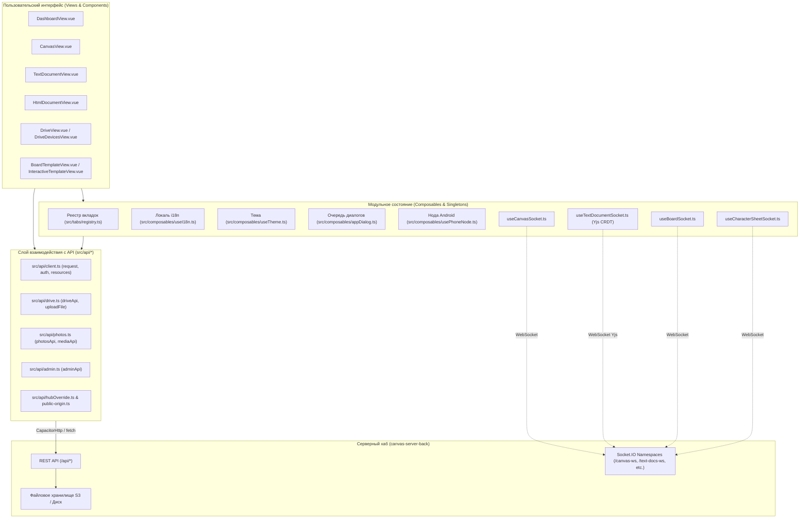

> Сверено с `q-space` @ c78a013, 2026-10-27.

# Архитектура веб-клиента QCanva (qcanva-client)

Веб-клиент QCanva — клиентское приложение системы Q Space, реализованное на **Vue 3, Vite и TypeScript**. Приложение собирается как веб-SPA для современных браузеров и компилируется в нативное Android-приложение через **Capacitor**.

Общая схема всей распределённой системы Q Space приведена в хабе: [docs/architecture/system.md](https://github.com/Qzarov/canvas-server-back/blob/q-space/docs/architecture/system.md).

---

## 1. Маршрутизация и структура страниц

Маршрутизатор сконфигурирован в [`src/router/index.ts`](../src/router/index.ts). Тонкая настройка ремонтирования компонентов при смене пути вынесена в [`src/router/view-remount.ts`](../src/router/view-remount.ts).

### Таблица маршрутов

| Путь маршрута | Имя маршрута | Компонент представления | Ограничения и Guards |
|---|---|---|---|
| `/login` | `login` | `src/views/LoginView.vue` | Публичный |
| `/register` | `register` | `src/views/RegisterView.vue` | Публичный |
| `/` | `landing` | `src/views/LandingView.vue` | Публичный |
| `/dashboard` | `dashboard` | `src/views/DashboardView.vue` | Доступен гостям (публичный режим) и пользователям |
| `/drive` | `drive` | `src/views/DriveView.vue` | `meta: { requiresAuth: true }` |
| `/drive/trash` | `drive-trash` | `src/views/DriveTrashView.vue` | `meta: { requiresAuth: true }` |
| `/drive/devices` | `drive-devices` | `src/views/DriveDevicesView.vue` | `meta: { requiresAuth: true }` |
| `/drive/:folderId` | `drive-folder` | `src/views/DriveView.vue` | `meta: { requiresAuth: true }` |
| `/html-docs` | `html-docs` | *Redirect* на `/dashboard?type=html` | `meta: { requiresAuth: true }` |
| `/edit/html/:id` | `html-document` | `src/views/HtmlDocumentView.vue` | Публичный (проверка прав и AccessGate внутри) |
| `/settings` | `settings` | `src/views/SettingsView.vue` | `meta: { requiresAuth: true }` |
| `/html-settings` | — | *Redirect* на `/settings?section=html` | Публичный редирект для обратной совместимости |
| `/docs/:id` | `text-document` | `src/views/TextDocumentView.vue` | Публичный (проверка прав и AccessGate внутри) |
| `/templates/:id` | `interactive-template` | `src/views/BoardTemplateView.vue` | `meta: { requiresAuth: true }` |
| `/mcp` | — | *Redirect* на `/settings?section=mcp` | Публичный редирект для MCP-клиентов |
| `/admin` | `admin` | `src/views/AdminView.vue` | `meta: { requiresAuth: true }` — клиент пускает любого вошедшего; роль admin/superadmin проверяет хаб (`AdminGuard`), иначе запросы страницы получают 403 |
| `/plugins` | `plugins` | `src/views/PluginsView.vue` | `meta: { requiresAuth: true }` |
| `/canvas/:id` | `canvas` | `src/views/CanvasView.vue` | Публичный (проверка прав и AccessGate внутри) |

### Хуки маршрутизатора и ремонтирование

- **`router.beforeEach`**: Проверяет флаг `to.meta.requiresAuth`. Если токен отсутствует (`isAuthenticated() === false`), перенаправляет на `/login` с сохранением `redirect`-параметра.
- **`router.afterEach`**: Сбрасывает базовый заголовок вкладки окна в `QCanva`. Если активна система вкладок (`tabsEnabled()`), регистрирует вкладку за текущим пользователем через `ensureTabsFor()` и активирует её через `showTab(to)`.
- **Точечное ремонтирование (`viewKeyFor`)**: Чтобы избежать мерцания экрана при смене UUID на человекочитаемый Slug (канонизация URL), глобальный ключ по всему пути не используется. Ремонтирование по полному пути (`REMOUNT_ON_PATH_CHANGE`) включено **только для текстовых документов** (`text-document`), так как смена ID документа требует пересоздания экземпляра TipTap, ProseMirror и Y.Doc. Канвасы и HTML-документы переключают содержимое через `watch`.

---

## 2. Представления (Views) и ключевые компоненты

### Представления (`src/views/`)

- `src/views/LoginView.vue`: форма аутентификации пользователя по email и паролю с поддержкой перенаправления.
- `src/views/RegisterView.vue`: форма создания нового аккаунта с именем, email и паролем.
- `src/views/LandingView.vue`: публичная посадочная страница с информацией о сервисе и ссылками на вход.
- `src/views/DashboardView.vue`: главное рабочее пространство с лентой недавних ресурсов, деревом папок, тегами и поиском.
- `src/views/DriveView.vue`: файловый менеджер облачного диска Q Space с поддержкой папок, загрузки файлов и фотоальбомов.
- `src/views/DriveTrashView.vue`: корзина удалённых файлов диска с возможностью восстановления и окончательного удаления.
- `src/views/DriveDevicesView.vue`: центр управления безопасностью Q Control (ЦУП), мониторинг устройств синхронизации и утерянных файлов.
- `src/views/HtmlDocumentView.vue`: редактор и изолированный предпросмотр HTML-документов с поддержкой PDF-экспорта и чекбоксов.
- `src/views/SettingsView.vue`: экран настроек аккаунта, тем оформления, языка, MCP-токенов и параметров ИИ-генерации.
- `src/views/TextDocumentView.vue`: совместный rich-text редактор TipTap + Yjs с поддержкой slash-команд, оглавления, упоминаний и обратных ссылок.
- `src/views/BoardTemplateView.vue`: контейнер интерактивных шаблонов, направляющий к канбан-доске или листу персонажа.
- `src/views/InteractiveTemplateView.vue`: интерактивный лист персонажа D&D 5e с режимами Setup и Play, дайсроллером и привязкой к канвасу.
- `src/views/AdminView.vue`: консоль администратора для управления пользователями, квотами хранилища и доступом к истории канвасов.
- `src/views/PluginsView.vue`: информационное представление об управлении плагинами непосредственно внутри ресурсов.
- `src/views/CanvasView.vue`: бесконечный совместный холст (whiteboard) с узлами, стрелками, рисованием, линейкой и встроенным чатом.

### Ключевые компоненты (`src/components/`)

- `src/components/AccessGate.vue`: экран ввода пароля или отправки заявки владельцу при блокировке 401/403.
- `src/components/AccessRequestDialog.vue`: модальный диалог отправки запроса на чтение или редактирование закрытого ресурса.
- `src/components/AccountMenu.vue`: меню профиля пользователя с переключением темы, переходом в настройки и выходом.
- `src/components/AppDialogHost.vue`: глобальный хост очереди модальных окон приложения (alert, confirm, prompt).
- `src/components/BackButton.vue`: кнопка возврата на предыдущий экран с индикатором открытых вкладок.
- `src/canvas/CanvasColorMenu.vue`: выпадающее меню выбора цветов заливки, границ и текста узлов канваса.
- `src/canvas/CanvasDrawingPanel.vue`: плавающая панель инструментов свободного рисования и геометрических фигур на канвасе.
- `src/components/CanvasLoader.vue`: ядро визуализации бесконечного канваса, рендеринга узлов, соединений и курсоров соавторов.
- `src/components/CanvasRulerSettings.vue`: модальное окно настройки единиц измерения (метры/футы) и масштаба совместной линейки.
- `src/components/ChatPanel.vue`: боковая панель группового чата канваса с цитированием сообщений и ссылками на узлы.
- `src/components/DriveDeviceFolderDialog.vue`: диалог инспекции правил репликации и подсчёта файлов папки на конкретном устройстве.
- `src/components/DriveDeviceRemoveDialog.vue`: диалог подтверждения отзыва/отключения устройства из центра Q Control.
- `src/components/DriveFileProperties.vue`: панель свойств файла с хешем SHA-256, метаданными, репликами и действиями телефона.
- `src/components/HubOverrideField.vue`: отладочное поле ввода для переключения URL хаба во время выполнения.
- `src/components/LanguageToggle.vue`: компактная кнопка переключения языка интерфейса (RU / EN).
- `src/components/ResourceSharePanel.vue`: панель доступа (видимость, пароль, slug, приглашения соавторов) для канвасов и текстовых документов; HTML-документы используют свою панель в `src/views/HtmlDocumentView.vue`.
- `src/components/ThemeMenu.vue`: плавающее меню быстрого выбора темы оформления для публичных экранов.
- `src/components/ThemeSelector.vue`: селектор темы оформления (Светлая, Тёмная, Системная).
- `src/components/ToastContainer.vue`: всплывающие уведомления (тосты) об успехе, ошибках или системных событиях.
- `src/components/board/BoardEditor.vue`: рабочая область канбан-доски с перетаскиванием колонок, карточек и привязкой документов.
- `src/components/board/BoardShareDialog.vue`: модальное окно приглашения соавторов и настройки прав доступа к канбан-доске.
- `src/components/dashboard/DashboardSidebar.vue`: боковая панель разделов (Главная, Диск, Папки, Доступные, Публичные) с деревом папок.
- `src/components/dashboard/DashboardViewToggle.vue`: переключатель сетки отображения ресурсов (плитка / табличный список).
- `src/components/dashboard/InteractiveTemplatePicker.vue`: диалог выбора типа интерактивного шаблона или импорта персонажа из JSON.
- `src/components/photos/DrivePhotos.vue`: виртуализированная галерея фотографий и видео с группировкой по месяцам и фильтром по лицам.
- `src/components/photos/PhotoViewer.vue`: полноэкранный модальный лайтбокс для просмотра фото и видео с зумом и навигацией.
- `src/components/settings/McpTokensPanel.vue`: панель выпуска и управления личными токенами доступа по протоколу MCP.
- `src/components/tabs/TabsButton.vue`: кнопка со счётчиком вкладок для вызова панели переключения активных ресурсов на Android.

---

## 3. Состояние приложения (State Management)

> [!IMPORTANT]
> **В клиенте нет Pinia и Vuex**: использование внешних библиотек управления состоянием исключено. Состояние распределено по **модульным реактивным синглтонам** (`reactive`, `ref`, `shallowRef`) и composables-функциям.

### Модульные синглтоны состояния

1. **Реестр вкладок приложения** — [`src/tabs/registry.ts`](../src/tabs/registry.ts):
   - Хранит список открытых вкладок: `const state = reactive<State>({ tabs: [], aliases: {}, activeKey: null })`.
   - Кэширует вкладки пользователя (до 8 вкладок, до 3 одновременно бодрствующих страниц в `<KeepAlive>`), персистится в `localStorage['qcanva:tabs:<userId>']`.
2. **Память скролла спящих вкладок** — [`src/tabs/scrollMemory.ts`](../src/tabs/scrollMemory.ts):
   - Хранит смещения скролла: `const positions = new Map<Element, { top: number; left: number }>()`.
   - Предотвращает сброс прокрутки DOM-элементов браузером при засыпании вкладки и восстанавливает позицию при пробуждении.
3. **Очередь системных диалогов** — [`src/composables/appDialog.ts`](../src/composables/appDialog.ts):
   - Очередь диалогов: `const queue = shallowRef<AppDialogEntry[]>([])`.
   - Обеспечивает асинхронные вызовы `confirmDialog()`, `alertDialog()`, `promptDialog()`, `confirmDelete()`.
4. **Система всплывающих тостов** — [`src/composables/useToast.ts`](../src/composables/useToast.ts):
   - Список уведомлений: `const toasts = ref<Toast[]>([])`.
   - Управляет временем отображения и авто-закрытием всплывающих сообщений.
5. **Тема оформления** — [`src/composables/useTheme.ts`](../src/composables/useTheme.ts):
   - Предпочтение темы: `const preference = ref<ThemePreference>(...)`.
   - Синхронизирует выбор пользователя (`light`, `dark`, `system`) с системным медиа-запросом и классами корневого элемента `document.documentElement`.
6. **Языковая локаль** — [`src/composables/useI18n.ts`](../src/composables/useI18n.ts):
   - Текущий язык: `const locale = ref<UiLocale>(initialLocale())`.
   - Синхронизирует значение с атрибутом `<html lang="...">` и хранилищем `localStorage['qcanva:locale']`.
7. **Стек кнопки «Назад» (Android Back Button)** — [`src/composables/useBackHandler.ts`](../src/composables/useBackHandler.ts):
   - Стек обработчиков: `const handlers: BackHandler[] = []`.
   - Реализует структуру LIFO: открытые диалоги, шторки и подпапки закрываются по кнопке «Назад» раньше, чем произойдёт выход из приложения или смена роута.
8. **Локальная нода хранения телефона** — [`src/composables/usePhoneNode.ts`](../src/composables/usePhoneNode.ts):
   - Модульное состояние: `availability`, `snapshot`, `permissions`, `policy`, `liveDownloads = reactive(new Map())`.
   - Управляет состоянием встроенного в Android Rust-агента хранения.
9. **Кэш подписанных токенов миниатюр фото** — [`src/api/photos.ts`](../src/api/photos.ts):
   - Кэш токенов: `const thumbTokens = new Map<string, { token: string; expiresAt: number }>()`.
   - Кеширует временные токены для отображения картинок Immich через защищённые URL без отправки Bearer-заголовка в ``.

---

## 4. API-слой (`src/api/*`)

Все HTTP-запросы к бэкенд-хабу централизованы в директории `src/api/`. Базовый URL формируется динамически через `resolveApiBase()` и по умолчанию имеет глобальный префикс `/api`. Все защищённые запросы автоматически добавляют заголовок `Authorization: Bearer <token>`.

### Карта модулей API и доменов хаба

| Файл модуля | Домен хаба / Назначение | Экспортируемые клиенты и функции |
|---|---|---|
| [`src/api/client.ts`](../src/api/client.ts) | Базовый транспорт, авторизация, канвасы, документы, теги, папки, MCP | `request()`, `auth`, `resourceFolders`, `canvas`, `htmlDocuments`, `textDocuments`, `interactiveTemplates`, `plugins`, `accessRequests`, `tags`, `mcpTokens`, `recentResources`, `uploadImage()` |
| [`src/api/drive.ts`](../src/api/drive.ts) | Диск Q Disk, файлы, папки, корзина, безопасность Q Control, устройства | `driveApi`, `uploadFile()`, `downloadDriveFile()`, `resolveDownloadUrl()`, утилиты размеров и реплик |
| [`src/api/photos.ts`](../src/api/photos.ts) | Медиаархив (Immich-интеграция), таймлайн, распознавание лиц | `photosApi`, `hubPhotosApi`, `mediaApi`, `withMediaUrls()`, `isPhotosEnabled()` |
| [`src/api/photos.mock.ts`](../src/api/photos.mock.ts) | Генератор мок-данных фото для разработки и тестов без хаба | `createPhotosMock()`, `isMockPhotoId()` |
| [`src/api/admin.ts`](../src/api/admin.ts) | Консоль администратора: лимиты файлов, квоты хранилища | `adminRequest()`, `adminApi` |
| [`src/api/hubOverride.ts`](../src/api/hubOverride.ts) | Отладочный резолв адреса хаба и WebSocket-ориджина | `resolveApiBase()`, `resolveWsOrigin()`, `isHubOverrideAllowed()`, `normalizeHubOverride()` |
| [`src/api/hubSwitch.ts`](../src/api/hubSwitch.ts) | Безопасная смена сервера с обязательным сбросом JWT токена | `applyHubOverride()` |
| [`src/api/public-origin.ts`](../src/api/public-origin.ts) | Вычисление канонического домена для ссылок общего доступа | `getPublicOrigin()` (защита от `https://localhost` в Capacitor) |

---

## 5. Реальное время и совместная работа (Realtime / Collaboration)

Клиент взаимодействует с WebSocket-сервером хаба на базе библиотеки **Socket.IO**. Каждому типу совместного ресурса выделен изолированный неймспейс (`${WS_URL}/<namespace>`).

### Таблица пространств имён WebSocket

| Ресурс | Namespace | Движок / Протокол | Ключевые события | Composable |
|---|---|---|---|---|
| Канвас | `/canvas-ws` | Операционные трансформации (`canvas-op`) с откатом к snapshot | `join-canvas`, `canvas-op`, `canvas-update`, `cursor-move`, `ruler-update`, `chat-send` | [`src/composables/useCanvasSocket.ts`](../src/composables/useCanvasSocket.ts) |
| Текстовые документы | `/text-docs-ws` | Yjs CRDT + TipTap (`y-prosemirror`, awareness) | `join-text-document`, `text-doc-update`, `text-doc-awareness`, `text-doc-room-state` | [`src/composables/useTextDocumentSocket.ts`](../src/composables/useTextDocumentSocket.ts) |
| Канбан-доски | `/boards-ws` | Секвенционированные ревизии операций доски | `join-board`, `board-op`, `board-op-applied`, `board-op-ack`, `board-room-state` | [`src/composables/useBoardSocket.ts`](../src/composables/useBoardSocket.ts) |
| Листы персонажей | `/character-sheets-ws` | Replay-движок поверх подтверждённого состояния | `join-sheet`, `sheet-op`, `sheet-applied`, `sheet-roll`, `sheet-rolled` | [`src/composables/useCharacterSheetSocket.ts`](../src/composables/useCharacterSheetSocket.ts) |
| HTML-документы | `/html-ws` | Ревизионные операции изменений HTML | `join-html`, `html-op`, `html-op-ack`, `html-room-state` | [`src/composables/useHtmlSocket.ts`](../src/composables/useHtmlSocket.ts) |

### Особенности реализации совместной работы

1. **Yjs CRDT в текстовых документах**: Текст хранится в виде двоичного Y.Doc. Изменения транслируются как base64-кодированные бинарные diff-пакеты (`text-doc-update`). Курсоры и выделения соавторов передаются через протокол Awareness без сохранения в историю документа.
2. **Канвас: гибридный OT и Snapshot Fallback**: При нормальной связи канвас шлёт точечные мутации `canvas-op`. При сетевых коллизиях, задержках ack или разрыве связи включается circuit breaker, сбрасывающий состояние в полный слепок `canvas-update` / `resync`.
3. **Лист D&D: Deterministic Replay**: Во избежание гонок при бросках кубиков и списании хитпоинтов клиент никогда не применяет удалённые операции напрямую к оптимистичному состоянию. Локальный интерфейс вычисляется путём накатывания очереди неподтверждённых локальных операций на серверную ревизию (`confirmedRevision`).

---

## 6. Интернационализация (i18n)

Интернационализация реализована в единственном файле [`src/composables/useI18n.ts`](../src/composables/useI18n.ts) без привлечения сторонних библиотек.

- **Поддерживаемые языки**: Русский (`ru`) и Английский (`en`).
- **Структура словаря**: `export const messages = { ru: { ... }, en: { ... } } as const;`.
- **Строгая проверка типов**: Тип ключа определён как `export type MessageKey = keyof typeof messages.en;`. TypeScript на этапе сборки контролирует, что каждый добавленный ключ присутствует в обоих словарях.
- **Хранение**: Выбранный язык хранится в `localStorage['qcanva:locale']`. По умолчанию язык определяется по заголовку браузера (`navigator.language.startsWith('ru') ? 'ru' : 'en'`).
- **Синхронизация с DOM**: При смене локали обновляется атрибут `<html lang="...">`, что обеспечивает корректные переносы слов и работу скринридеров.

---

## 7. Переменные окружения и флаги (`VITE_*`)

*(Приведены только имена и влияние на поведение; значения и секреты опущены согласно правилам)*

| Имя переменной | Где используется в коде | Назначение и влияние на поведение |
|---|---|---|
| `VITE_API_URL` | [`src/api/hubOverride.ts`](../src/api/hubOverride.ts) | Базовый URL хаба по умолчанию при сборке (например, `http://localhost:3001/api`), если не задан оверрайд |
| `VITE_CANONICAL_ORIGIN` | [`src/api/public-origin.ts`](../src/api/public-origin.ts) | Канонический домен сервиса для формирования публичных ссылок общего доступа (предотвращает утечку localhost) |
| `VITE_ALLOW_HUB_OVERRIDE` | [`src/api/hubOverride.ts`](../src/api/hubOverride.ts), [`capacitor.config.ts`](../capacitor.config.ts) | При значении `1` включает UI смены адреса хаба в настройках и разрешает Mixed Content (HTTP) в WebView Android для отладки на стендах |
| `VITE_PHOTOS_ENABLED` | [`src/api/photos.ts`](../src/api/photos.ts) | Фича-флаг: при значении `1` включает раздел «Фото» и переключатель «Файлы/Фото» на Диске |
| `VITE_PHOTOS_MOCK` | [`src/api/photos.ts`](../src/api/photos.ts) | Мок-флаг: при значении `1` подставляет локальные сгенерированные фото и лица вместо реального API Immich хаба |

---

## 8. Сборка Android и Capacitor

Приложение адаптировано под сборку в нативный APK/AAB для Android с использованием **Capacitor 8**.

- **Конфигурация ([`capacitor.config.ts`](../capacitor.config.ts))**:
  - `appId`: `pro.qzarov.qcanva`, `webDir`: `dist`.
  - `androidScheme`: `https`. Внутренний WebView загружает веб-ресурсы с локального адреса `https://localhost`.
  - `CapacitorHttp`: встроенный HTTP-плагин активирован, поэтому все стандартные вызовы `fetch()` выполняются через нативный сетевой стек Android, минуя ограничения CORS WebView.
  - `allowMixedContent`: динамически включается, если сборка производилась с `VITE_ALLOW_HUB_OVERRIDE=1` (для локальных стендов без SSL).
- **Спящий режим и вкладки ([`src/tabs/`](../src/tabs/))**:
  - На мобильных устройствах открытые документы и канвасы преобразуются во вкладки, управляемые динамическими хостами (`TabHost.ts`) внутри `<KeepAlive :include="liveHostNames">`.
  - При сворачивании вкладки вызывается хук сна (`useViewActivity`), который отключает фоновые таймеры и слушатели, а `src/tabs/scrollMemory.ts` запоминает позицию скролла.
- **Встроенная нода хранения (`qspace-agent`)**:
  - Пакет Android включает нативный плагин `QSpaceAgent` ([`src/native/qspaceAgent.ts`](../src/native/qspaceAgent.ts)), связывающийся через FFI с демоном синхронизации на Rust.
  - Демон работает в Android Foreground Service и обеспечивает синхронизацию файлов устройства с диском хаба в фоновом режиме.

---

## 9. Тестирование

### Unit и компонентные тесты (Vitest)
- **Конфигурация**: [`vitest.config.ts`](../vitest.config.ts), расширяет базовый [`vite.config.ts`](../vite.config.ts).
- **Файл окружения**: [`src/test-setup.ts`](../src/test-setup.ts) добавляет jsdom-заглушки `Element.prototype.scrollIntoView` и `Range.prototype.getClientRects` / `getBoundingClientRect`.
- **Изоляция зависимостей**: В блоке `server.deps.inline` принудительно трансформируются `tippy.js`, `@tiptap/vue-3`, `@tiptap/extension-bubble-menu`, `@tiptap/extension-drag-handle`, что устраняет проблемы ESM/CJS резолвинга в среде Node.js.
- **Запуск**: `npm run test:unit -- --maxWorkers=2` (согласно [docs/rules.md](rules.md)).

### Скриншотные регрессионные тесты (Playwright)
- **Конфигурация**: [`playwright.config.ts`](../playwright.config.ts).
- **Область проверки**: Регрессионные тесты тем оформления и цветовых палитр (`tests/theme.visual.spec.ts`).
- **Параметры проверки**: `maxDiffPixelRatio: 0.01`, автоматический запуск dev-сервера на порту 4175 с отключением анимаций.
- **Запуск**: `npm run test:visual`.

---

## 10. Потоки данных приложения

